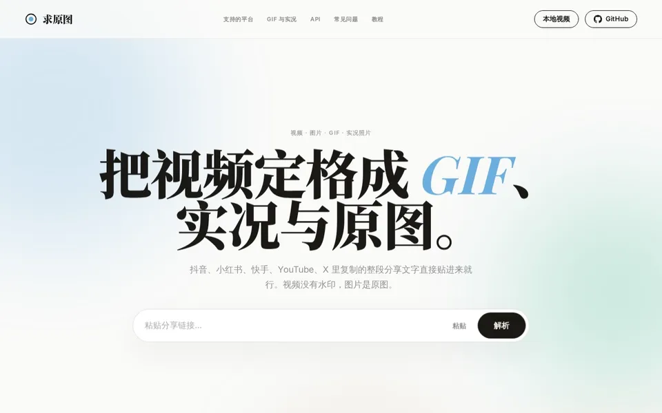

<div align="center">

<picture>
  <source media="(prefers-reduced-motion: reduce)" srcset="docs/logo.svg">
  <source type="image/svg+xml" srcset="docs/logo-animated.svg">
  
</picture>

# Qiuyuantu · 求原图

**A self-hosted media downloader with GIF, Live Photo and Motion Photo conversion.**

Save videos and original images from Douyin, Xiaohongshu, YouTube, X, Bilibili and more. Paste a share link or upload a local video to get started.

[](https://github.com/hiyufan/shizhen/actions/workflows/ci.yml)
[](pyproject.toml)
[](LICENSE)

[简体中文](README.md) · [English](README.en.md)

**[Try it online](https://ynvan.com)** · [Quick start](#quick-start) · [Documentation](#documentation) · [Report a bug](https://github.com/hiyufan/shizhen/issues)

</div>

<p align="center">
  
  <br>
  <sub>Paste a link → preview the original media → download or trim a clip into a GIF.</sub>
</p>

## Features

- **Download and convert in one place.** Extract media, choose a clip on the thumbnail strip, and make a GIF, iPhone Live Photo or Android Motion Photo.
- **Keep the original media.** Save platform-provided watermark-free video streams and original-size images. Package supported platform Live Photos without re-encoding.
- **Use your own videos.** Upload files up to 300 MB, then choose the clip, speed and cover frame.
- **Run it yourself.** Free and MIT licensed, with a browser UI, HTTP API and Docker Compose deployment.

## Supported platforms

Supports 30+ platforms. Available formats and quality depend on the source:

| Media | Platforms |
| --- | --- |
| Videos and images | Douyin, Xiaohongshu, Kuaishou, YouTube, X, Bilibili, Instagram and more |
| Still and animated artwork | [QQ Music](https://ynvan.com/qq-music-cover), [NetEase Cloud Music](https://ynvan.com/netease-music-cover), [Apple Music](https://ynvan.com/apple-music-cover) |
| Game assets | [Steam animated avatars, frames and backgrounds](https://ynvan.com/steam-assets), [HoYoPlay launcher wallpapers](https://ynvan.com/hoyoplay-wallpaper), [Wuthering Waves international wallpaper](https://ynvan.com/wuthering-waves-wallpaper) |
| Anonymous stickers & Channels | [Cataloged Telegram stickers](https://ynvan.com/telegram-stickers) (TGS to transparent GIF / Live Photo), [Channels downloader](https://ynvan.com/wechat-channels) (public service supplies video for downloading and conversion) |
| Public Discord stickers | [Public packs and individual stickers](https://ynvan.com/discord-stickers): original APNG / Lottie JSON downloads, transparent GIFs, Live Photos and Motion Photos; no account token |
| Community & theme assets | [MiYouShe post images and GIFs](https://ynvan.com/miyoushe-images), [public Bilibili themes and collections](https://ynvan.com/bilibili-assets) |
| Pixiv | [Illustrations, manga and novel TXT](https://ynvan.com/pixiv-download), [Ugoira to GIF / Live Photo](https://ynvan.com/pixiv-ugoira), [Sketch originals](https://ynvan.com/pixiv-sketch); browse public directories by page, without an account |

See the [platform and format matrix](docs/usage.en.md#supported-platforms) for supported media types, quality options and limitations. Music tools extract artwork only.

## Quick start

### Use it online

Open **[ynvan.com](https://ynvan.com)**, paste a share link, and select **Parse**. Download the result, or choose a clip to convert. No account is required on the site. Step-by-step instructions are in the [guides](https://ynvan.com/guides).

### Run locally

Requires **Python 3.10+** and Git.

```bash
git clone https://github.com/hiyufan/shizhen.git
cd shizhen
./start.sh
```

On Windows PowerShell, replace `./start.sh` with `.\start.ps1`. The first run creates `.venv` and installs dependencies. Open **<http://127.0.0.1:8000>** after startup. FFmpeg is taken from `PATH` or the bundled `imageio-ffmpeg` binary.

<details>
<summary>Manual installation / single Docker container</summary>

Manual installation (macOS / Linux):

```bash
python -m venv .venv
.venv/bin/python -m pip install -e ".[web,cli]"
.venv/bin/python main.py
```

On Windows, use `.venv\Scripts\python.exe` instead of `.venv/bin/python`.

Single Docker container:

```bash
docker build -t shizhen .
docker run -d -p 8000:8000 -v ./data:/app/data shizhen
```

</details>

## Production deployment

Clone the repository and enter its directory as above. Point your domain at the server, then run:

```bash
DOMAIN=your.domain docker compose up -d
```

Compose starts the app, Caddy with automatic HTTPS, a YouTube PO Token service and WARP. See [self-hosting and configuration](docs/self-hosting.en.md) for proxies, cookies, quotas and deployment requirements.

## FAQ

<details>
<summary>Can a webpage save a Live Photo directly to iPhone Photos?</summary>

The webpage exports paired JPG + MOV files; it cannot write a Live Photo directly into iPhone Photos. Import the pair through Mac Photos, or save the video and convert it with a phone app. Android Motion Photos require a compatible gallery.

</details>

<details>
<summary>Why does extraction fail on a supported platform?</summary>

Links can expire, content may require login, and platforms can restrict server IPs. Check the [platform status](https://ynvan.com/status), copy a fresh share link, and consult [self-hosting troubleshooting](docs/self-hosting.en.md#production-deployment) if you run your own instance.

</details>

<details>
<summary>Does the basic Python installation include all YouTube dependencies?</summary>

Full YouTube support also needs EJS, a JavaScript runtime and a working outbound connection. Docker includes additional dependencies and download fallbacks; see [self-hosting](docs/self-hosting.en.md#production-deployment) and [YouTube diagnostics](docs/youtube.md) (Chinese) for manual installation and limitations.

</details>

## Documentation

| Goal | Guide |
| --- | --- |
| Platforms, formats and artwork tools | [Usage](docs/usage.en.md) |
| Server configuration, proxies and quotas | [Self-hosting](docs/self-hosting.en.md) · [CI/CD](docs/deploy.md) · [ESA relay](docs/esa-relay.md) |
| YouTube restrictions and download failures | [YouTube diagnostics](docs/youtube.md) |
| API integration and development | [Development and API](docs/development.en.md) |
| Independent Douyin account workflow | [Account assistant](apps/douyin-inbox/README.md) |

CI/CD, ESA relay, YouTube diagnostics and account assistant guides are currently in Chinese.

## Contributing

Found a bug or have a feature request? [Search existing issues](https://github.com/hiyufan/shizhen/issues) or [open an issue](https://github.com/hiyufan/shizhen/issues/new). For bugs, include a reproducible public link, expected behavior, the error message and your deployment method.

Contributions to parsers, tests, translations and documentation are welcome. Start with [CONTRIBUTING.md](CONTRIBUTING.md#english).

If Qiuyuantu saves you time, consider giving it a Star or sharing it with someone who could use it.

<details>
<summary>Acknowledgments</summary>

- [parse-video-py](https://github.com/wujunwei928/parse-video-py): the project's starting point; some smaller-platform integrations still use the APIs it discovered
- [yt-dlp](https://github.com/yt-dlp/yt-dlp): YouTube and fallback extraction
- [FFmpeg](https://ffmpeg.org/) / [imageio-ffmpeg](https://github.com/imageio/imageio-ffmpeg): media conversion
- [FastAPI](https://fastapi.tiangolo.com/) · [httpx](https://www.python-httpx.org/) · [piexif](https://github.com/hMatoba/Piexif)
- [bgutil-ytdlp-pot-provider](https://github.com/Brainicism/bgutil-ytdlp-pot-provider) · [fxtwitter](https://github.com/FixTweet/FxTwitter)
- Fonts: [Noto Serif SC](https://fonts.google.com/noto/specimen/Noto+Serif+SC), [Inter](https://rsms.me/inter/), [Playfair Display](https://github.com/clauseggers/Playfair), [JetBrains Mono](https://www.jetbrains.com/lp/mono/)
- Video in the opening demo: [Big Buck Bunny](https://peach.blender.org/) © Blender Foundation, [CC BY 3.0](https://creativecommons.org/licenses/by/3.0/)

</details>

## Disclaimer and license

This project is intended for personal learning and research. Respect creators' copyright and do not use it to infringe their rights. Operators are responsible for services they deploy using this project.

[MIT License](LICENSE) © 2026 hiyufan, including the upstream parse-video-py copyright notice.

Formerly Shizhen (拾帧), renamed Qiuyuantu (求原图) in October 2026. The repository URL remains `hiyufan/shizhen`. Package names and upgrade steps: [development guide](docs/development.en.md#package-names-and-upgrades).
