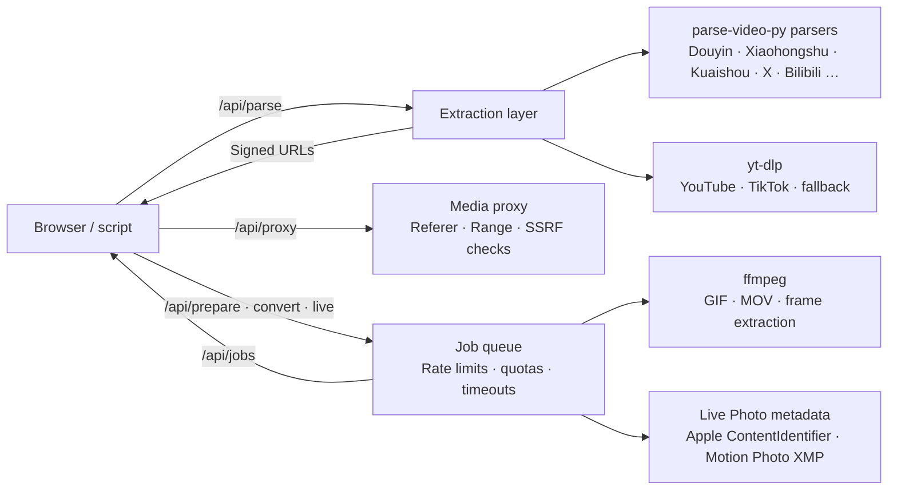

# Development and API

[Back to README](../README.en.md) · [简体中文](development.md)

[Contributing](#contributing) · [Package names and upgrades](#package-names-and-upgrades) · [Architecture](#architecture) · [API](#api) · [Roadmap](#roadmap)

## Contributing

Issues and pull requests are welcome.

```bash
git clone https://github.com/hiyufan/shizhen.git && cd shizhen
python -m venv .venv && .venv/bin/pip install -e ".[web,cli,dev]"
.venv/bin/python main.py
```

- **Code quality**: Ruff formats and checks Python; see `pyproject.toml` for the 120-character line limit, complexity ≤ 10, import sorting, and common bug checks. ESLint checks frontend scripts; see `eslint.config.mjs` for complexity ≤ 10, nesting ≤ 4 levels, and functions ≤ 80 lines. Failed CI checks block deployment. Run `pre-commit install` to run Ruff automatically on commits; before committing frontend changes, run `npx --yes eslint@10 src/qiuyuantu/static/js`. Tests: `python -m pytest -q`, with no external network access.
- **Layering**: `parser/` handles links → `VideoInfo`, without HTTP endpoints. `convert/` handles downloads, conversion, and the job queue without depending on FastAPI. `web/` validates input, handles authentication and rate limits, and delegates the work. Frontend scripts belong in `static/js/`, organized by feature; do not add inline executable scripts to templates.
- **Adding a platform**: implement a `BaseParser` subclass in `src/qiuyuantu/parser/` and register domains in `parser/__init__.py`. Return `VideoInfo`; directly downloadable quality options belong in `formats` with a `url`, while formats requiring server-side merging use `format_spec`.
- **Editing copy**: landing page content lives in `seo.py`, tutorials in `guides.py`. After editing site copy, run `python scripts/subset_fonts.py --src <NotoSerifCJK-OTF-directory>` to rebuild serif font subsets. The 900 weight includes only large page headings; `tests/test_fonts.py` checks for missing characters. Font URLs include content hashes automatically.
- **Porting upstream fixes**: local parsers have been rewritten to use `BaseParser.get_json / get_text` and raise `ParseError` with a reason. Do not replace them with whole upstream files. Compare changes, port the relevant fix, and add offline cases in `tests/test_small_parsers.py`.
- **Outbound requests**: always use `utils.create_async_client()` or `convert.net.safe_client()`, which provide per-hop SSRF checks and connection pooling. Do not instantiate `httpx.AsyncClient()` directly.
- Before submitting behavior changes, verify one real link each from Douyin, Xiaohongshu, X, and Bilibili, and run each of the three conversion formats once.

### Checks

Run checks from the repository root with the development virtual environment active. CI uses Python 3.12 and Node.js 22; see [the workflow](../.github/workflows/ci.yml) for the current commands.

| Change | Checks |
| --- | --- |
| Python, tests or dependencies | `python -m ruff format --check .`, `python -m ruff check .`, `python -m pytest -q` |
| Account assistant or shared parsing / conversion code | Also run `python -m pytest -q apps/douyin-inbox/tests` |
| Frontend JavaScript | `npx --yes eslint@10 src/qiuyuantu/static/js` and browser interaction checks |
| Templates, styles, assets or page copy | `python -m pytest -q tests/test_assets.py tests/test_fonts.py tests/test_csp.py tests/test_seo_routes.py` and desktop / mobile browser checks |
| Deployment script | `shellcheck scripts/deploy.sh` |
| Dockerfile or dependencies | `docker build -t shizhen-ci .` when Docker is available |
| Documentation only | Check facts, local links, and `git diff --check` |

Run `python apps/douyin-inbox/scripts/sync_readme.py --check` to verify the generated account assistant section. Pre-commit runs Ruff only; it does not replace the other checks. Offline tests do not establish real-platform success: report real-link and conversion smoke tests separately.

## Package names and upgrades

The Python package, distribution, and CLI are all named `qiuyuantu`, for example `from qiuyuantu import parse_video_share_url` and `qiuyuantu version`. CLI features require the `cli` extra. Legacy `parse_video_py` imports, including submodules, the `parse-video-py` command, and `python -m parse_video_py.diag` remain compatible. HTTP endpoints and `PARSE_VIDEO_*` environment variables keep their existing names and behavior.

When upgrading an older source installation, first run `python -m pip uninstall parse-video-py` in its virtual environment, then install this repository using the commands in [Contributing](#contributing). This avoids having two distributions provide the legacy entry points. For Docker installations, rebuild the image. The repository remains at `hiyufan/shizhen`.

## Architecture



```text
main.py                          Startup entry point
src/parse_video_py/               Legacy package compatibility; forwards to qiuyuantu on demand
src/qiuyuantu/
  parser/                        Upstream-derived platform parsers; enhanced douyin / redbook / twitter parsers
  parser/ytdlp.py                General yt-dlp parser and quality options
  parser/errors.py               Extraction error classification
  convert/ffmpeg.py              FFmpeg wrapper: GIFs, clip encoding, frames, thumbnail strips, progress
  convert/livephoto.py           Apple MakerNote / MOV identifiers and Motion Photo XMP
  convert/tasks.py               Background jobs: prepare video, convert GIF / Live Photo / Motion Photo, package originals
  convert/fetch.py               Streaming downloads, relay fallback for Chinese CDNs, yt-dlp download / merge
  convert/bilibili.py            Bilibili HD and audio-only downloads: select DASH tracks and merge
  convert/jobs.py · store.py     Job queue, source video cache, disk quotas
  convert/net.py                 SSRF protection, URL signatures, outbound connection pools
  convert/relay.py               Edge function relay transport
  convert/updater.py             Automatic yt-dlp updates
  diag.py                        Admin diagnostics: python -m qiuyuantu.diag <link>
  web/app.py                     FastAPI assembly: background task lifecycle, middleware, routes
  web/legacy_api.py              Upstream-compatible endpoints and response formats
  web/limits.py                  Per-IP rate limits and concurrency quotas
  web/pages.py · parse.py        Pages and SEO landing pages; /api/parse extraction, /api/feedback failure reports
  web/proxy.py · media.py        /api/proxy forwarding; source preparation, conversion, downloads, job queries
  web/admin.py · middleware.py   Health, statistics, test mode; security headers and page view tracking
  feedback.py                    Failure feedback: GitHub issues, encrypted emails, retesting and email notifications
  stats.py                       SQLite event statistics, time-bucket summaries, /stats page
  seo.py · guides.py             Landing pages, tutorials, JSON-LD, sitemap
  templates/                     base / index / guide / guides / stats / 404
  static/                        Self-hosted fonts, subset serif fonts, styles, Open Graph images
  static/js/                     ES modules: app, result, converter, trimmer, save, api, ui, dom,
                                 site animations, stats. Directory served under /js/<content-hash>/
scripts/push_urls.py             Baidu URL submission and sitemap ping
scripts/esa-relay.js             Alibaba Cloud ESA edge function: /probe outbound checks, /relay for Chinese platforms
scripts/subset_fonts.py          Rebuild serif font subsets after copy changes
docker/youtube/worker.py         Native YouTube session downloads and media validation in an isolated interpreter
docker-compose.yml · Caddyfile   HTTPS deployment on a single machine
```

## API

The website uses these same endpoints. You can call them from shortcuts, scripts, or your own app. The upstream parse-video-py endpoints `/video/share/url/parse`, `/video/id/parse`, and `/mcp` are preserved.

```bash
curl -s "https://ynvan.com/api/parse?url=https://v.douyin.com/8x0AeP8prW8/"
```

```jsonc
{
  "code": 200,
  "data": {
    "source": "douyin",
    "title": "济公爷爷为大家祈福啦…",
    "author": { "name": "济公爷爷·游本昌" },
    "duration": 49.5, "width": 720, "height": 1280,
    "video_url": "https://…/play/….mp4",
    "music_url": "https://….mp3",
    "images": [{ "url": "…", "live_photo_url": "…" }],
    "formats": [{ "label": "720p H.265", "url": "…", "filesize": 126185059 }],
    "sig": { "https://…/play/….mp4": "3f9c…" }          // Signature for each URL; required by the endpoints below
  }
}
```

Extraction results may include an `assets` array for independent theme and collection media: `{url, label, kind: image|animation|video|archive|file, cover_url, ext}`. These are separate assets rather than quality variants or native Live Photo pairs. Existing `images`, `formats`, JSON and SSE contracts remain available; asset and preview URLs are signed in `sig`. Send `image: true` to `/api/prepare` for animated images; use normal preparation for videos.

Pixiv / Sketch directories use `entries: [{url, title, cover_url, kind, available}]`, `entry_total` and `next_page_url`. An empty `content_kind=directory` page is valid. `documents: [{title, content}]` holds plain text rendered through text nodes and local TXT downloads, never HTML. `animation_frames: [{file, delay}]` provides timing JSON. Original Ugoira ZIPs belong in `assets` (`kind=archive`); composed MP4 uses `formats[].format_spec=pixiv-ugoira`. Preparation re-fetches trusted platform metadata and keeps signing, quotas, cancellation and the existing job queue. Directory references are not signed as media; only their preview images are. Selecting a work uses the normal extraction endpoint.

| Method | Path | Description |
|---|---|---|
| `POST` | `/api/parse` · `/api/parse/stream` | JSON `{url}`; used by the website to keep Signal share parameters out of query strings. GET compatibility endpoints remain available |
| `GET` | `/api/parse?url=` | Extract from share text / links. Failures return a `reason`: `deleted` `login` `blocked` `network` `timeout` `unsupported` `empty` `parse` |
| `GET` | `/api/parse/stream?url=` | Stream real extraction stages, followed by the same final result as the JSON endpoint; used by the website for stage messages, elapsed time, and a fallback indicator |
| `GET` | `/api/proxy?url=&sig=&filename=&download=1` | Proxy direct media URLs with Range support; accepts only URLs signed in extraction results |
| `POST` | `/api/prepare` | `{url \| page_url, sig, title}` caches the source video on the server and returns a `source_id` or background job |
| `POST` | `/api/upload` | Multipart video or animation; videos return a source, animations a preparation job, Spine ZIPs `animation_upload` and `animations` for selection |
| `POST` | `/api/animation/prepare` | `{upload_id, animation}` selects an actual animation from an uploaded Spine ZIP and returns a preparation job |
| `GET` | `/api/source/{id}` · `/strip?n=` | Source preview · thumbnail strip; `?download=1` downloads the prepared MP4. The additive source field `animation` identifies animation preparation |
| `POST` | `/api/convert` | `{source_id, format: gif\|livephoto\|motionphoto, start, end, fps, width, dither, speed, key_time}` |
| `POST` | `/api/live` | `{items: [{image_url, video_url, image_sig, video_sig}], format, title}` packages original platform Live Photos |
| `POST` | `/api/download` | `{page_url, format_spec, sig, title}` downloads and merges media server-side with yt-dlp |
| `GET` | `/api/jobs/{id}` · `/file` · `/preview` · `/video` | Job progress · output file · Live Photo cover · Live Photo MOV |
| `DELETE` | `/api/jobs/{id}` | Cancel a job; only the initiating client may do so |
| `GET` | `/api/health` | Queue, disk usage, and yt-dlp version |

Extraction progress uses SSE: `{type: "progress", stage, fallback}` in `data` reports a real stage, and `{type: "result", result}` carries the final JSON result. When a platform needs a slow quality check (currently the highest Douyin tier from the official playback endpoint), `result` carries `pending: true` with the formats already known; once the check finishes the stream sends `{type: "update", result}` if more formats were found, otherwise `{type: "done"}`, and the website updates the download buttons in place. The JSON endpoint, CLI, and account assistant still wait for the check, so their results are unchanged. The website uses conversational status text, shows actual elapsed time, and keeps a fallback indicator visible once a fallback is activated. Cache hits do not flash a waiting bar. Clearing the input or changing links stops the previous request and timer. Stage events do not expose cookies, PO Tokens, or internal service details. The original JSON extraction endpoint remains available.

Job endpoints return `{id, status: queued|running|done|error, progress, message, filename, filesize}`. Poll `/api/jobs/{id}` until `done`, then fetch `/file`. Rate limits return `429` with a `Retry-After` header.

## Roadmap

- [x] 30+ platform parsers with yt-dlp fallback
- [x] GIF / iPhone Live Photo / Android Motion Photo conversion
- [x] Original Xiaohongshu and Douyin Live Photo packaging
- [x] Public deployment protections: rate limits, quotas, signatures, SSRF prevention, CSP
- [x] Landing pages, tutorials, and structured data
- [x] Outbound connection reuse, reducing extraction / media request latency by 66% / 69%
- [ ] iOS Shortcut: save extraction results directly to the photo library, including Live Photos
- [ ] Batch operations: extract multiple links / download an entire image gallery as an archive
- [ ] Live Photos from more platforms, including Weibo and Instagram
- [ ] Multi-instance scaling: external job state and shared output storage; moving state alone does not solve local output files
- [ ] Contribute Douyin quality options, Xiaohongshu original images, and the X fallback back to upstream parse-video-py
