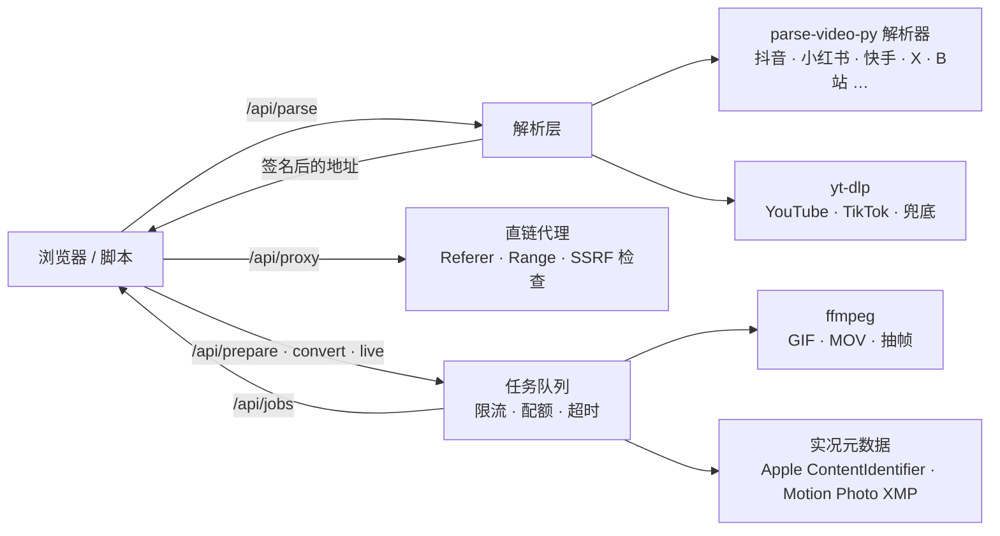

# 开发与 API

[返回 README](../README.md) · [English](development.en.md)

[贡献](#贡献) · [包名与旧版升级](#包名与旧版升级) · [架构](#架构) · [API](#api) · [路线图](#路线图)

## 贡献

欢迎 Issue 和 PR。

```bash
git clone https://github.com/hiyufan/shizhen.git && cd shizhen
python -m venv .venv && .venv/bin/pip install -e ".[web,cli,dev]"
.venv/bin/python main.py
```

- **规范**：Python 用 ruff 格式化和检查（规则在 `pyproject.toml`：行宽 120、圈复杂度 ≤ 10、import 排序、常见 bug 写法），前端脚本用 ESLint（`eslint.config.mjs`：复杂度 ≤ 10、嵌套 ≤ 4 层、函数 ≤ 80 行），CI 里任何一项不过就不部署。`pre-commit install` 后每次提交自动跑 ruff；前端提交前跑 `npx --yes eslint@10 src/qiuyuantu/static/js`。测试：`python -m pytest -q`，不碰外网。
- **分层**：`parser/` 只管「链接 → VideoInfo」，不碰 HTTP 接口；`convert/` 是下载、转换、任务队列，不认识 FastAPI；`web/` 只做参数校验、鉴权、限流，把活交给前两层。前端脚本在 `static/js/`，按功能分模块，不往模板里写内联脚本。
- **加平台**：在 `src/qiuyuantu/parser/` 写一个 `BaseParser` 子类，在 `parser/__init__.py` 注册域名。返回 `VideoInfo`，直链多档清晰度放 `formats`（带 `url`），需要服务端合并的放 `format_spec`。
- **改文案**：落地页在 `seo.py`，教程在 `guides.py`。改完跑 `python scripts/subset_fonts.py --src <NotoSerifCJK OTF 目录>` 重建衬线字体子集（900 字重只收各页大标题，`tests/test_fonts.py` 会查缺字）。字体 URL 自动带内容哈希，不用管缓存。
- **同步上游**：`parser/` 里的解析器都已按本项目的写法重写过（统一用 `BaseParser.get_json / get_text` 发请求、失败抛带原因的 `ParseError`），不能再拿上游文件直接覆盖；上游修了某个平台时对照着改，并补上 `tests/test_small_parsers.py` 里的离线用例。
- **发起出站请求**：一律用 `utils.create_async_client()` 或 `convert.net.safe_client()`，它们带 SSRF 逐跳检查并复用连接池。不要直接 `httpx.AsyncClient()`。
- **普通账号工作流**：独立应用见 [apps/douyin-inbox/README.md](../apps/douyin-inbox/README.md)，源码、测试、部署与运维文档都在该目录；主包与 Web 镜像不包含账号助手。
- 提交前用真实链接验证：抖音、小红书、X、B站 各一条，三种转换格式各一次。

### 验证检查

在仓库根目录、已激活的开发虚拟环境中执行。CI 使用 Python 3.12、Node.js 22，完整命令以 [CI 工作流](../.github/workflows/ci.yml) 为准。

| 改动 | 检查 |
| --- | --- |
| Python、测试或依赖 | `python -m ruff format --check .`、`python -m ruff check .`、`python -m pytest -q` |
| 账号助手或共享解析 / 转换代码 | 另跑 `python -m pytest -q apps/douyin-inbox/tests` |
| 前端 JavaScript | `npx --yes eslint@10 src/qiuyuantu/static/js`，以及浏览器交互检查 |
| 模板、样式、资源或页面文案 | `python -m pytest -q tests/test_assets.py tests/test_fonts.py tests/test_csp.py tests/test_seo_routes.py`，以及桌面 / 手机检查 |
| 部署脚本 | `shellcheck scripts/deploy.sh` |
| Dockerfile 或依赖 | 具备 Docker 环境时执行 `docker build -t shizhen-ci .` |
| 纯文档 | 核对事实、本地链接，运行 `git diff --check` |

运行 `python apps/douyin-inbox/scripts/sync_readme.py --check` 检查账号助手嵌入同步。Pre-commit 只运行 Ruff，不能替代其他检查。离线测试不能证明真实平台可用，真实链接与转换烟测需单独报告。

## 包名与旧版升级

Python 包、安装包和命令行入口统一为 `qiuyuantu`，例如 `from qiuyuantu import parse_video_share_url`、`qiuyuantu version`。命令行功能需安装 `cli` extra。旧的 `parse_video_py` 导入（含子模块）、`parse-video-py` 命令和 `python -m parse_video_py.diag` 继续兼容；HTTP 接口及 `PARSE_VIDEO_*` 环境变量保持原有用法。

源码部署从旧版本升级时，先在原虚拟环境中运行 `python -m pip uninstall parse-video-py`，再按[贡献](#贡献)一节的命令安装当前仓库，避免两个发行包同时提供旧入口。Docker 部署重新构建镜像即可。仓库地址仍为 `hiyufan/shizhen`。

## 架构



```
apps/douyin-inbox/               独立抖音账号助手：源码、测试、部署与文档
main.py                          启动入口
src/parse_video_py/               旧包名兼容入口，按需转发到 qiuyuantu
src/qiuyuantu/
  parser/                        上游解析器（抖音 / 小红书 / 快手 / X / B站 …），本项目增强了 douyin / redbook / twitter
  parser/ytdlp.py                yt-dlp 通用解析器，清晰度列表
  parser/errors.py               解析错误分类
  convert/ffmpeg.py              ffmpeg 封装：GIF、切段编码、抽帧、缩略图条、进度
  convert/livephoto.py           Apple MakerNote / MOV 标识、Motion Photo XMP
  convert/tasks.py               后台任务：准备原视频、转 GIF / 实况 / 动态照片、实况打包
  convert/fetch.py               下载：直链流式下载、国内 CDN 走中继兜底、yt-dlp 下载合并
  convert/bilibili.py            B 站高清与仅音频下载：挑选 DASH 分轨并合并
  convert/jobs.py · store.py     任务队列、原视频缓存、磁盘配额
  convert/net.py                 SSRF 防护、链接签名、出站连接池
  convert/relay.py               边缘函数中继 transport
  convert/updater.py             yt-dlp 自动升级
  diag.py                        站长诊断：python -m qiuyuantu.diag <链接>
  web/app.py                     组装 FastAPI：后台任务启停、中间件、路由
  web/legacy_api.py              上游兼容接口，保留原有请求路径与返回格式
  web/limits.py                  按 IP 限流与并发配额
  web/pages.py · parse.py        页面与 SEO 落地页；/api/parse 解析、/api/feedback 失败反馈
  web/proxy.py · media.py        /api/proxy 直链转发；原视频准备、转换、下载、任务查询
  web/admin.py · middleware.py   健康检查、统计、测试模式；安全响应头与浏览统计
  feedback.py                    解析失败反馈：GitHub issue、加密邮箱、修好后复测再发邮件
  stats.py                       使用统计：SQLite 事件表、按时间分桶汇总，/stats 页面
  seo.py · guides.py             落地页与教程内容、JSON-LD、sitemap
  templates/                     base / index / guide / guides / stats / 404
  static/                        自托管字体（衬线按站内用字子集化）、样式、OG 图
  static/js/                     前端 ES 模块：app（首页入口）· result · converter · trimmer · save · api · ui · dom，
                                 site（全站动效）、stats（统计页）。整目录按内容哈希挂在 /js/<版本>/ 下
scripts/push_urls.py             百度主动推送 + sitemap ping
scripts/esa-relay.js             阿里云 ESA 边缘函数：/probe 探测出口，/relay 给海外服务器当国内中继
scripts/subset_fonts.py          改文案后重建衬线字体子集
docker/youtube/worker.py         独立解释器中的 YouTube 原生会话下载与媒体验证
docker-compose.yml · Caddyfile   一台机器的 HTTPS 部署
```

## API

网页用的就是这几个接口，快捷指令、脚本、自己的 App 都能接。上游 parse-video-py 的 `/video/share/url/parse`、`/video/id/parse`、`/mcp` 原样保留。

```bash
curl -s "https://ynvan.com/api/parse?url=https://v.douyin.com/8x0AeP8prW8/"
```

```jsonc
{
  "code": 200,
  "data": {
    "source": "douyin",
    "title": "济公爷爷为大家祈福啦…",
    "author": { "name": "济公爷爷·游本昌" },
    "duration": 49.5, "width": 720, "height": 1280,
    "video_url": "https://…/play/….mp4",
    "music_url": "https://….mp3",
    "images": [{ "url": "…", "live_photo_url": "…" }],
    "formats": [{ "label": "720p H.265", "url": "…", "filesize": 126185059 }],
    "sig": { "https://…/play/….mp4": "3f9c…" }          // 每个地址的签名，下面的接口都要带
  }
}
```

解析结果新增可选的 `assets` 数组，用于装扮和收藏集里的独立素材：`{url, label, kind: image|animation|video|archive|file, cover_url, ext}`。这些不是同一视频的不同清晰度，也不是原生实况配对。原有 `images`、`formats`、JSON 与 SSE 接口继续可用；所有素材地址与预览图均在 `sig` 中签名。动态图片传 `image: true` 到 `/api/prepare`，视频使用普通准备流程。

闲鱼商品支持 `goofish.com/item?id=…` 和指向闲鱼的 `m.tb.cn` 分享短链，`source=goofish`。解析器仅使用 H5 公开详情和本次请求的匿名签名令牌，返回商品图片与公开视频地址，不读取账号 Cookie。图片保留接口提供的文件地址与查询参数，可能自带水印；原始尺寸不代表无水印。淘宝、天猫商品链接暂不支持。

Web 结果的 `download_format` 为默认视频下载档位，包含已有 `formats` 中的直链或服务端选择器，或默认预览流的下载信息。`video_url` 仍用于兼容预览；调用方不要据此假定它总是最高档。`formats` 可包含 `width`、`fps`、`bitrate`（bit/s）元数据，最高画质与原文件的逐平台核验见 [画质核验](quality.md)。

Pixiv / Sketch 目录使用 `entries: [{url, title, cover_url, kind, available}]`、`entry_total` 与 `next_page_url`；`content_kind=directory` 的空页也是有效目录。`documents: [{title, content}]` 为纯文本，前端通过文本节点与本地 TXT 下载呈现，不能当 HTML 插入。`animation_frames: [{file, delay}]` 供时序 JSON 下载；Ugoira 原始 ZIP 放 `assets`（`kind=archive`），合成 MP4 使用 `formats[].format_spec=pixiv-ugoira`。准备任务重新读取可信平台元数据，并复用现有签名、配额、取消与任务队列。目录引用不签成媒体地址，只有预览图加入媒体签名；点击作品后走原有解析接口。

| 方法 | 路径 | 说明 |
|---|---|---|
| `POST` | `/api/parse` · `/api/parse/stream` | JSON `{url}`；网页使用 POST，避免 Signal 分享包参数进入查询字符串。GET 兼容接口保留 |
| `GET` | `/api/parse?url=` | 解析分享文字 / 链接。失败时返回 `reason`：`deleted` `login` `blocked` `network` `timeout` `unsupported` `empty` `parse` |
| `GET` | `/api/parse/stream?url=` | 同一次解析实时发送阶段事件，最后发送与 JSON 接口相同的结果；网页据此显示轻松的阶段提示、等待时间和备用方式标记 |
| `GET` | `/api/proxy?url=&sig=&filename=&download=1` | 转发直链，支持 Range；只接受解析结果里签过名的地址 |
| `POST` | `/api/prepare` | `{url \| page_url, sig, title}` 把原视频缓存到服务端，返回 `source_id` 或后台任务 |
| `POST` | `/api/upload` | multipart 上传视频或动画；普通视频返回 source，动画返回准备任务，Spine ZIP 返回 `animation_upload` 和 `animations` 供选择 |
| `POST` | `/api/animation/prepare` | `{upload_id, animation}` 从已上传 Spine ZIP 选择真实动画名称，返回准备任务 |
| `GET` | `/api/source/{id}` · `/strip?n=` | 预览视频 · 缩略图条；`?download=1` 下载已准备的 MP4。source 元数据的 `animation` 表示来自动画准备 |
| `POST` | `/api/convert` | `{source_id, format: gif\|livephoto\|motionphoto, start, end, fps, width, dither, speed, key_time}` |
| `POST` | `/api/live` | `{items: [{image_url, video_url, image_sig, video_sig}], format, title}` 平台实况图原样打包 |
| `POST` | `/api/download` | `{page_url, format_spec, sig, title}` 服务端用 yt-dlp 合并下载 |
| `GET` | `/api/jobs/{id}` · `/file` · `/preview` · `/video` | 任务进度 · 结果文件 · 实况封面 · 实况 MOV |
| `DELETE` | `/api/jobs/{id}` | 取消任务（仅发起者） |
| `GET` | `/api/health` | 队列、磁盘、yt-dlp 版本 |

解析状态流为 SSE：`data` 中的 `{type: "progress", stage, fallback}` 表示真实阶段，`{type: "result", result}` 是最终 JSON 结果。网页保留轻松的文案，显示实际等待时间，并在进入兜底后持续标记「备用方式已启用」；缓存命中不闪等待条，清空或换链接会停止旧请求和计时。阶段事件不传 Cookie、PO Token 或内部服务信息，原 JSON 解析接口继续可用。

任务接口都返回 `{id, status: queued|running|done|error, progress, message, filename, filesize}`，轮询 `/api/jobs/{id}` 直到 `done` 后取 `/file`。限流触发时返回 `429` 并带 `Retry-After`。

## 路线图

- [x] 30+ 平台解析，yt-dlp 兜底
- [x] GIF / iPhone 实况 / 安卓动态照片
- [x] 小红书、抖音实况图原样打包
- [x] 公网加固：限流、配额、签名、SSRF、CSP
- [x] 落地页 + 教程 + 结构化数据
- [x] 出站连接池复用，解析与下载提速 66% / 69%
- [ ] iOS 快捷指令：解析结果一键存入相册（含实况）
- [ ] 批量：一次解析多个链接 / 整篇图集打包下载
- [ ] 更多平台的实况图（微博、Instagram）
- [ ] 多实例扩容：任务状态外置 + 产物共享存储（两件都要做，只搬状态解决不了产物在本机磁盘的问题）
- [ ] 把抖音多档清晰度、小红书原图、X 兜底回馈给上游 parse-video-py
